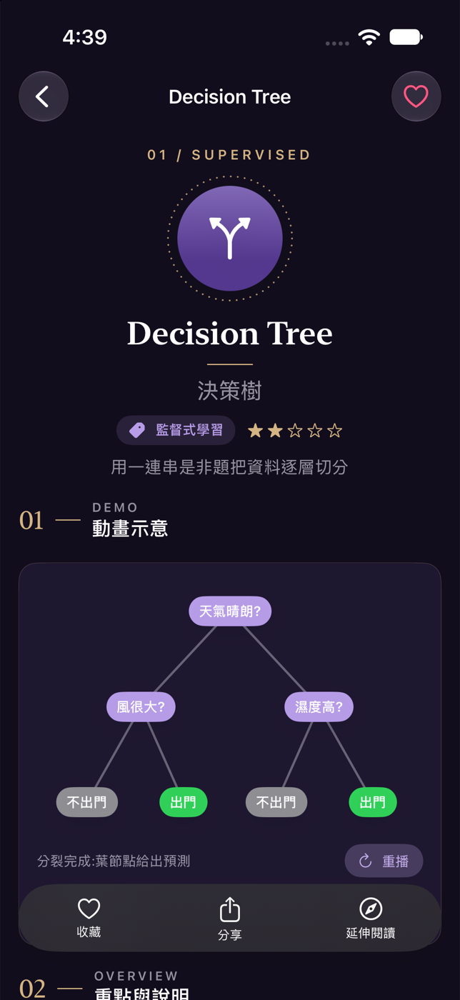
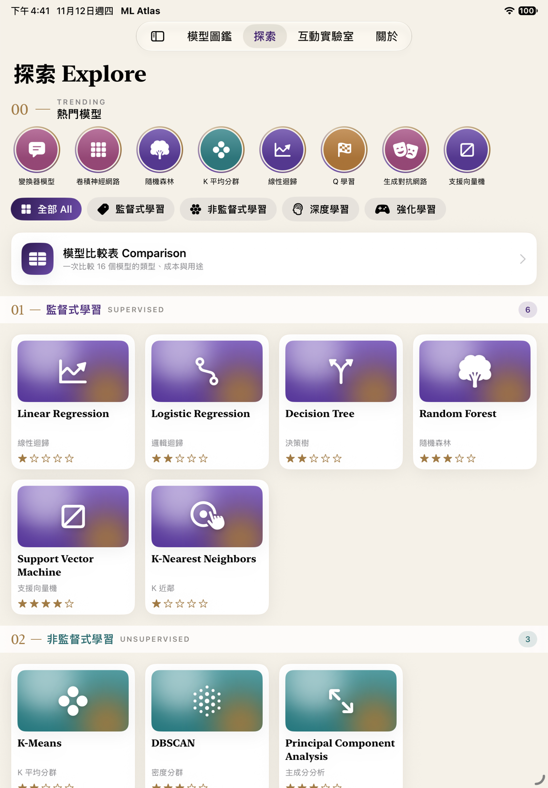

# ML Atlas|機器學習模型圖鑑

用 SwiftUI 打造的互動式電子書 App,以圖鑑的形式介紹 16 個機器學習模型。每個模型都有中英雙語說明和一段專屬的示意動畫,看完概念還能動手玩。支援 iPhone / iPad 與淺色 / 深色模式。

| 圖鑑頁 | 詳情頁(深色) | iPad |
| --- | --- | --- |
|  |  |  |

## 特色

- **16 個模型,16 段動畫**:從線性迴歸的梯度下降、K-Means 收斂、決策樹分裂,到 CNN、Transformer 注意力與 GAN 對抗訓練,每個模型都有可重播或可互動的示意動畫。
- **像翻書一樣閱讀**:詳情頁以「概念 → 原理 → 應用」水平分頁,圖鑑頁頂端有 ML 簡介輪播,優缺點可展開收合。
- **探索與比較**:卡片牆依類別篩選,分類標題釘在畫面上方;比較表整理類型、是否需要標註資料、可解釋性、訓練成本與典型用途。
- **互動實驗室**:用 Slider 即時調整 blur、hueRotation、saturation 等圖片效果,切換 transition,觸發 SF Symbol 動畫,並可一次瀏覽全部 16 個動畫。
- **延伸閱讀**:內嵌 Wikipedia、scikit-learn 文件,使用 iOS 26 原生 `WebView`。
- **影片與圖庫**:播放內建介紹影片或網路影片,圖庫以 `AsyncImage` 載入並處理失敗狀態。
- **收藏與外觀**:左滑或點愛心收藏模型,外觀可選系統 / 淺色 / 深色,設定會被記住。
- **iPhone 與 iPad**:tab bar 在 iPhone 位於下方,在 iPad 位於上方並可展開成側邊欄。

## 設計風格

深紫主色、淡米色底、金色細線、01 / 02 數字標號與襯線標題,營造印刷書籍般的典雅氣質;同時保留 iOS 的原生特色:系統導覽列與 tab bar、圓角卡片、SF Symbols、New York 襯線字體與 Dynamic Type。色票集中在 `Assets.xcassets` 與 `Modifiers/CardStyle.swift`。

## 技術重點

| 主題 | 做法 | 位置 |
| --- | --- | --- |
| 資料模型 | `struct` + `Identifiable`、`enum` 類別,16 筆資料 | `Models/` |
| 導覽 | `NavigationStack` + `NavigationLink(value:)` | `Views/ModelListView.swift` |
| 清單 | 依類別分 Section、搜尋、左滑收藏 | `Views/ModelListView.swift` |
| 分頁容器 | `TabView` + `Tab`,`.sidebarAdaptable` | `Views/RootTabView.swift` |
| 水平分頁 | `TabView(.page)` 輪播;`ScrollView` + `.scrollTargetBehavior(.paging)` | `Views/IntroCarouselView.swift`、`Views/DetailPagerView.swift` |
| 動畫 | `withAnimation`、自訂 `Shape` + `animatableData`、`trim`、`matchedGeometryEffect`、`TimelineView` + `Canvas` | `Components/Demos/` |
| 轉場 | `asymmetric` 與組合式 `.transition` | `Views/ModelDetailView.swift`、`Views/LabView.swift` |
| SF Symbol 動畫 | `bounce`、`wiggle`、`pulse`、`variableColor` 等 `symbolEffect` | `Views/LabView.swift` |
| 網頁 | iOS 26 原生 `WebView` + `WebPage`,含進度條與錯誤重試 | `Views/WebReaderView.swift` |
| 卡片牆與比較表 | `LazyVGrid` + `GridItem(.adaptive)`;`Grid` | `Views/ExploreView.swift`、`Views/ComparisonTableView.swift` |
| 釘選標題 | `LazyVStack(pinnedViews:)`,垂直捲動中嵌入水平捲動 | `Views/ExploreView.swift` |
| 影片 | AVKit `VideoPlayer`,內建 mp4 與網路 HLS | `Views/VideoSectionView.swift` |
| 圖片 | `AsyncImage` phases(載入中、成功、失敗) | `Views/RemoteGalleryView.swift` |
| 圖片效果 | blur、brightness、contrast、saturation、grayscale、hueRotation、colorInvert、colorMultiply、mask、blendMode | `Views/LabView.swift` |
| 樣式複用 | 自訂 `ViewModifier`:`CardStyle`、`SoftShadow`、`SectionTitleStyle`、`ChipStyle` | `Modifiers/CardStyle.swift` |
| 狀態 | `@Observable` 收藏、`@AppStorage` 外觀設定 | `Models/FavoritesStore.swift`、`Models/AppearanceMode.swift` |
| 外觀 | Asset Catalog 顏色組、App Icon(淺色 / 深色 / Tinted)、Launch Screen | `Resources/Assets.xcassets`、`project.yml` |

## 動畫一覽

| 模型 | 動畫 | 技術 |
| --- | --- | --- |
| Linear Regression | 梯度下降 60 步,回歸線與殘差逐步擬合 | 自訂 `Shape` + `animatableData`、spring |
| K-Means | 點被指派到最近中心,中心移到平均位置,直到收斂 | `withAnimation`、spring |
| Decision Tree | 節點逐層分裂,連線長出來 | `trim`、`scaleEffect`、spring |
| KNN | 點一下放置查詢點,高亮最近 k 個鄰居並投票 | `SpatialTapGesture`、`.transition` |
| MLP / DQN | 訊號沿連線逐層傳遞,神經元發亮 | `TimelineView` + `Canvas` |
| Logistic Regression、Random Forest、SVM、DBSCAN、PCA、CNN、RNN / LSTM、Transformer、GAN、Q-Learning | 各自的概念示意 | `TimelineView` + `Canvas` |

「互動實驗室 → 動畫總覽」可以一次看完全部 16 個動畫。示意動畫使用固定種子產生的示範資料,用來說明概念,並非實際訓練結果。

## 環境需求

- Xcode 26 以上(開發與測試使用 Xcode 27.2 與 iOS 27 模擬器),Swift 6
- 最低支援 iOS 26,Universal(iPhone + iPad)
- 沒有任何第三方套件;圖像全部由 SF Symbols 與 SwiftUI(`Shape`、`Canvas`)繪製

## 執行方式

1. 用 Xcode 開啟 `MLAtlas.xcodeproj`。
2. 選擇 `MLAtlas` scheme 與任一 iPhone 或 iPad 模擬器,按 ⌘R。
3. 要在實機執行時,到 Target → Signing & Capabilities 選擇自己的 Team,並把 Bundle Identifier(預設 `com.example.MLAtlas`)改成自己的。

命令列編譯:

```bash
xcodebuild -project MLAtlas.xcodeproj -scheme MLAtlas -destination 'platform=iOS Simulator,name=iPhone 17 Pro' build
```

專案檔由 [XcodeGen](https://github.com/yonaskolb/XcodeGen) 依 `project.yml` 產生。新增或搬移檔案後執行 `xcodegen generate` 即可更新;沒有安裝 XcodeGen 也能直接使用現有的 `.xcodeproj`。

## 專案結構

```
MLAtlas.xcodeproj          Xcode 專案
project.yml                XcodeGen 設定(含 Info.plist 內容)
MLAtlas/
  MLAtlasApp.swift         App 進入點
  Models/                  MLModel、16 筆資料、收藏、外觀設定
  Views/                   每個畫面一個檔案
  Components/              列、卡片、FlowLayout
  Components/Demos/        16 個模型的示意動畫
  Modifiers/               自訂 ViewModifier
  Resources/               Assets.xcassets、intro.mp4
Scripts/
  generate_assets.swift    產生 App Icon 與 Launch 圖
  generate_video.swift     用 AVFoundation 產生 intro.mp4
landing-page/index.html    App 介紹頁(單一 HTML 檔)
docs/screenshots/          模擬器截圖
```

## 重新產生素材

```bash
swift Scripts/generate_assets.swift .
```

```bash
swift Scripts/generate_video.swift MLAtlas/Resources/intro.mp4
```

想換成自己的影片:用同名的 `intro.mp4` 取代 `MLAtlas/Resources/intro.mp4`;網路影片則修改 `VideoSectionView.networkURL`(需為 mp4 或 HLS)。

## 備註

- 網頁閱讀、圖庫與網路影片需要網路連線,離線時會顯示對應的錯誤畫面。
- 目前收錄 16 個模型,Gradient Boosting、Hierarchical Clustering、Autoencoder、Diffusion、PPO 預計之後加入。
- 動畫尚未依「減少動態效果」的輔助使用設定調整。
